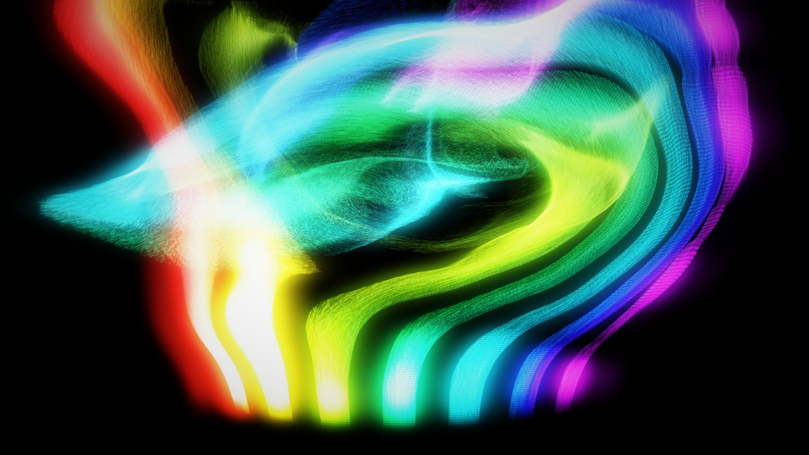
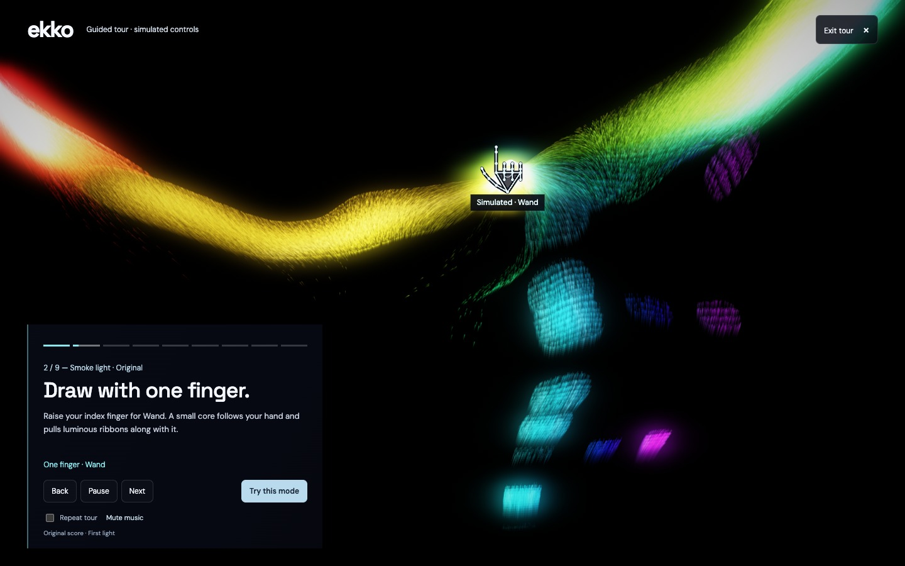
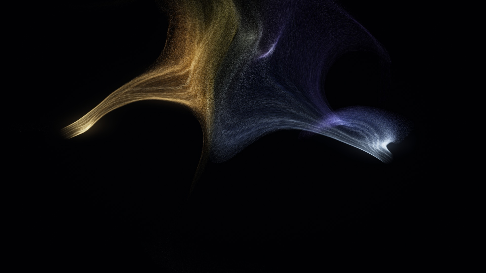
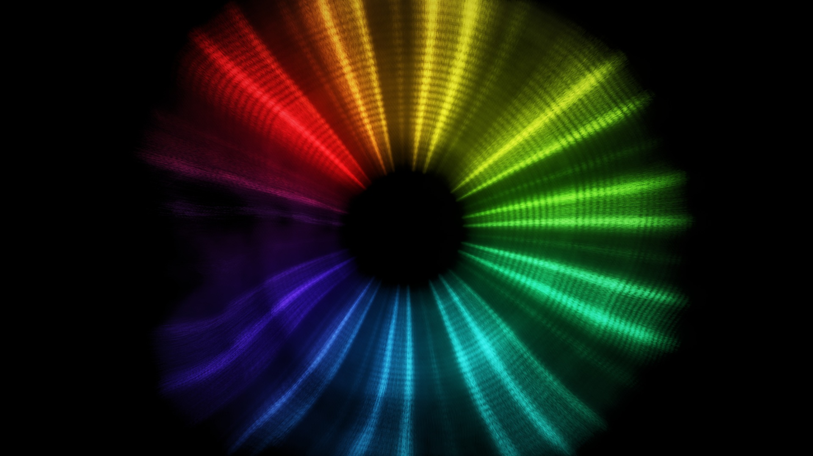
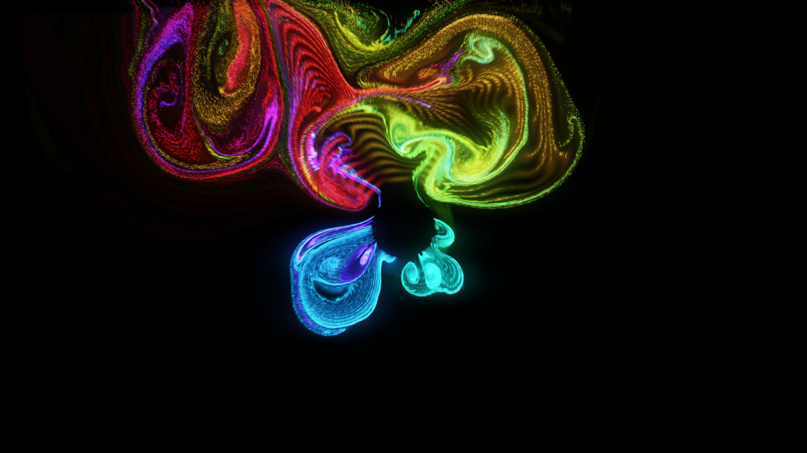
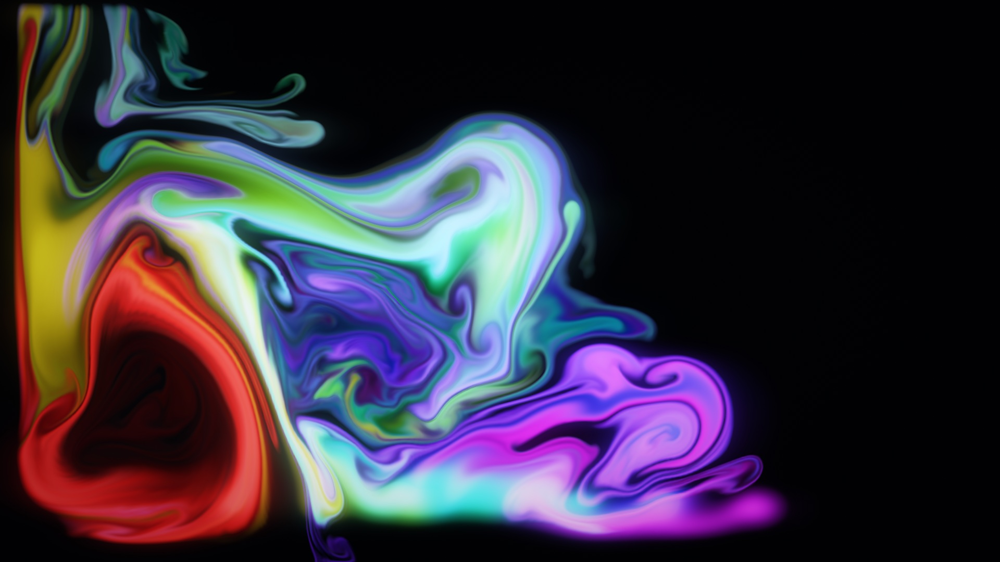
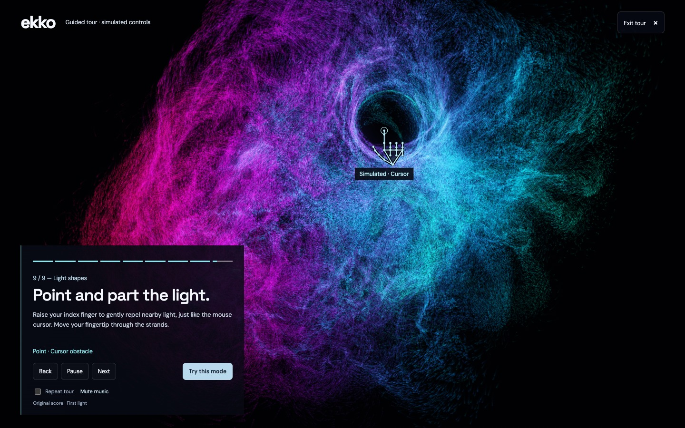
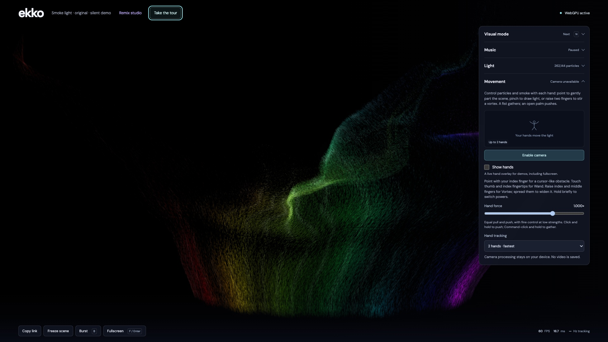
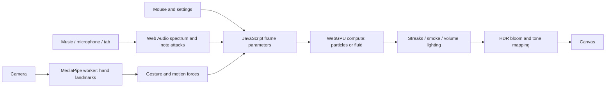

# EKKO

**Sound into smoke. Your hands into motion.**

EKKO is an interactive music visualizer built with WebGPU. Bass launches jets of smoke, high notes light up fine ribbons, and your hands gather, twist and scatter the scene. It runs in the browser, with fluid simulation, millions of particles, and glowing light calculated on your GPU.



*Smoke light · Original — a million particles turning the audio spectrum into luminous, folded ribbons.*

[Remix Studio](#remix-studio-gallery-and-ai-agents) · [Guided tour](#take-the-guided-tour) · [Get started](#run-locally) · [Visual modes](#choose-your-scene) · [Hand controls](#shape-it-with-your-hands) · [Music](#let-the-music-drive-it) · [How WebGPU works](#how-webgpu-powers-ekko) · [Developer guide](#explore-the-code)

## Take the guided tour

Choose **Take the tour** in the header for a three-minute journey through all nine modes. An original instrumental loop, *First light*, plays through the same audio analyser as your own music. If you already have a song loaded or a live input connected, the tour uses that source instead. No audio library download is needed for the built-in score.

Animated hand skeletons demonstrate pointing, pinch-to-Wand, Vortex, Gather and Push. A simulated cursor demonstrates hover, click-and-hold, and Command-click gathering. The drawings and the simulation share the same positions: you see the controls that are actually affecting the smoke and particles. Camera tracking does not influence the tour.

- **Back / Next** or the nine chapter markers jump between scenes.
- **Pause / Resume** freezes the demonstration and pauses file playback. Live audio keeps playing in its source. Switching away from the tab pauses the tour.
- **Mute music** silences file playback while keeping its spectrum connected to the visuals.
- **Repeat tour** loops the chapters for an unattended showcase.
- **Try this mode** hands the current scene and its visual tuning over to you.
- **Exit tour** or **Escape** restores your previous mode, tuning, particle settings and file playback position/state. Tour settings are temporary until you choose **Try this mode**.

The tour uses the real WebGPU renderer, with automatic particle quality adjustment. Its controls are simulated and labelled; it cannot replace practising with your own hands or mouse. You can run it without allowing camera access.



*The tour uses live audio-reactive rendering; the labelled hand shows the force moving the ribbons.*

## Try this first

1. Start the app and choose **Fluid ring** or **Smoke light · Original**.
2. Pick **Audio file** to open a song from your device, or choose a song from the library if its audio files are installed.
3. Select **Rainbow**, turn up **Audio response**, and press **F** for fullscreen.
4. Move the mouse through the scene. Hold a click to push; hold **Command-click** to gather.
5. Allow camera access to use your hands: make a fist to gather, then open your palm to release the light.

The scene also animates without audio. Opening a saved link or reloading keeps music paused; press **Space** when you are ready.

## Choose your scene

| Mode | What you see and control |
| --- | --- |
| **Fluid ring** | Nine smoke jets radiating from a circle. Bass begins at the upper left; higher frequencies continue clockwise. Note attacks kick the jets outward, carrying light into twisting filaments. |
| **Smoke light · Lasting glow** | Continuous smoke ribbons that catch light when a note starts. Each illuminated patch travels with the smoke and slowly fades. |
| **Smoke light · Original** | Rising, folded sheets of luminous particles. Seven frequency bands feed the emitter; the music can also flash across smoke already in the air. |
| **Fluid smoke** | Buoyant smoke you can stir. Bass hits fire upward on the left, while higher notes feed the lanes to the right. |
| **Fire & ice** | Two rolling vortex bundles, warm and cool in the matching palette. Streams curl, fold and meet as the music and your hands disturb them. |
| **Hand fire & ice** | Cast bright energy jets with sparks and a rolling smoke wake. Point to aim; move closer for more particles or farther away for a gentler stream. Other gestures keep their usual forces. Music pulses each source independently. |
| **Spectral smoke** | A full-circle spectrum of fine filaments inside softly shaded volumetric smoke. Nine frequency sectors control emission and lighting. |
| **Particle ring** | Outward streams of particles that accelerate with bass intensity. Pull and push the ring with your hands or mouse. |
| **Airbender** | A persistent cloud of particles. Gather them into an orbit, drag them across the screen, then send them flying. |
| **Light shapes** | Music-reactive geometry: Wave wreath, Light ribbons, Wave field and Angular trails. Hand forces disturb the shapes as they move. |



*Fire & ice — two rolling vortex fields carrying warm and cool streams into sweeping folds.*

| Spectral smoke | Fluid ring |
| --- | --- |
|  |  |
| Fine particles draw the edges; a coarse volume supplies soft light and depth. | A fluid velocity field carries both smoke and fine particle tracers. |



*Fluid smoke — heat, colour and transported light moving through a pressure-projected velocity field.*

In **Fluid smoke settings**, turn on **Remove walls** to let smoke flow through every edge and fade as it leaves. The setting is remembered on this device and included in copied links.

**Emission amount** controls the overall supply in Fluid smoke, Fluid ring, Spectral smoke, Particle ring, both Smoke light modes and Fire & ice. **Spectrum emission** multiplies that supply according to activity: quiet bands emit less and active bands emit more. At 1×, 20% activity gives 0.4× emission and 80% gives 1.6×; 0 disables the extra multiplier and 2 increases the contrast. Ring and lane emitters use their own frequency band; Particle ring and Fire & ice use overall activity. Without active music, this multiplier leaves the idle scene unchanged. Both controls are saved per mode and included in copied links.

These are screenshots of the running app, captured at 1920 × 1080 with music playing and controls hidden. The gallery uses higher particle counts and boosted glow/audio response; it shows live output, not prerendered artwork. See [capture settings](docs/images/captures.json) for the selected frames.

In **Hand fire & ice**, one source gets bass. Two hands take bass and mid; an additional mouse source takes treble. Hands have priority over the mouse. With more sources, assignments span the nine measured frequency bands (up to eight hands plus the mouse). Intermediate positions blend neighbouring bands. Tracking IDs keep assignments stable when hands cross; adding or removing a source redistributes the spectrum. Move the mouse to aim; after five seconds idle it hides and stops emitting. Leaving the scene or holding a mouse button also stops its source. Only an index-finger pointing gesture emits from a hand. Fists, open palms, pinches and two-finger poses retain Gather, Push, Wand and Vortex interactions. A gentler stream stays visible between notes; each note controls the amount and carried glow of new particles. Existing trails fade naturally when a source moves or disappears. Midrange emission lifts quieter notes so roughly 25% mid activity produces a similar stream to 90% bass activity. Treble emission also has extra sensitivity and particle output. Bass hits widen every source at birth, including mid and treble streams; existing trails continue undisturbed. Use Speed, Turbulence, Glow, Emission amount and Spectrum emission to tune this mode.

## Shape it with your hands

Camera tracking turns hand landmarks into forces in the simulation. The preview mirrors your movement, and **Show hands** adds a skeleton and gesture labels over the scene, including in fullscreen.

| Gesture | Action |
| --- | --- |
| Raise your index finger | **Cursor:** gently repel nearby particles and smoke at your fingertip. Move closer to the camera to grow the effect, or farther away to shrink it (a quarter to four times the selected pointing size). Each new pointing gesture resets the distance reference. |
| Pinch thumb and index fingertips together | **Wand:** gather light into a small moving core at the pinch. |
| Raise index and middle fingers | **Vortex:** stir an orbit. Spread the fingertips to widen it. |
| Close your hand | **Gather:** pull particles into orbit. |
| Open your palm | **Push:** repel the scene. Opening a closed hand also triggers a burst. |

Hold gestures briefly to switch powers. Pinching works with the other fingers raised or curled. Three raised fingers have no special effect. **Hand force** adjusts pull and push together, with fine control at low strengths. Choose tracking for **2, 4 or 8 hands** to let more people join in; two hands has the lowest tracking load.




The app attempts to start the camera after WebGPU initialises, subject to browser permission. Use **Stop camera / Enable camera** in Movement to control it. The **Show hands** checkbox only controls the overlay. You can use the mouse and music without a camera.

Hand detection runs locally in a MediaPipe worker, with smoothing and bounded prediction to keep movement responsive between tracking results. Camera frames are neither uploaded nor saved by the app.

In Hand fire & ice, pointing casts energy jets instead of forming a cursor obstacle; all other gestures work as above. Camera distance uses the same gesture-start reference and smoothed ¼×–4× power range as the pointing obstacle. Power changes the particle birth rate, jet speed and casting glow; it never increases the allocated particle pool. Each particle keeps its birth power and colour as it flies. The smoke wake uses soft drifting particles, alongside fine energy filaments and sparse ballistic sparks.

## Let the music drive it

EKKO measures the audio spectrum and sudden rises in energy. Different modes use bass/mid/treble levels, seven emission bands, or nine independently measured ring bands. A kick can launch smoke while a higher note illuminates a different part of the scene.

**Audio response** changes visual sensitivity and jet strength without changing playback volume. **Glow** changes the spread of light. In Lasting glow and the fluid modes, emitted light moves with the smoke after the note ends.

| Source | How to use it |
| --- | --- |
| **Library** | Select an installed song to start it. The song selection and playback position are remembered; a reload always restores playback paused. |
| **Audio file** | Choose a local audio file. It is analysed and played on your device; the last selected file may be cached locally for the next visit. |
| **Microphone** | Let live sound drive the scene. Microphone input is analysed without being played back or recorded. |
| **Tab audio** | Choose **Share tab**, select a browser tab playing music or video, and enable **Share tab audio** in the browser picker. Playback stays in the original tab. |
| **YouTube** | Paste a single-video link and select **Load audio**. Known library links reuse the hosted files; other links require the optional import API described below. |

Tab audio depends on browser and sharing-surface support; the app's UI guides desktop Chrome/Edge users through the picker. **Stop sharing** disconnects EKKO without pausing the original tab. Refreshing requires sharing again. The browser also supplies a display track, which EKKO does not render, record or upload.

## Make it your own

<details>
<summary>See the controls alongside the live scene</summary>



</details>

- **Seven palettes:** Aurora, Ember, Ocean, Rainbow, Neon, Silver, and Fire & ice.
- **Per-mode settings:** speed and glow, plus turbulence, emission or particle visibility where supported. Each mode remembers its own values. Particle visibility brightens individual points independently of bloom.
- **Fullscreen and hidden controls:** fill the screen with the scene, then move to the right edge to reveal the settings drawer. All control sections collapse.
- **Freeze scene:** stop simulation motion independently of music playback to inspect a fold or composition.
- **Native, 4K or Auto resolution:** keep crisp output or let the app reduce rendering cost.
- **Automatic particle quality:** target 60 FPS, or choose a manual count up to **3,145,728**, where GPU buffer limits permit.
- **Copy link:** share the mode, palette, tuning, source selection, library song and playhead. Local audio bytes and camera/microphone/tab permissions stay on the original device.
- **Live telemetry:** see frame rate, frame time and hand-tracking performance in the footer.

| Shortcut | Action |
| --- | --- |
| **Space** | Play/pause music; start/stop the selected live input. |
| **N** | Next visual mode. |
| **1–7** (top row) | With controls hidden: Aurora, Ember, Ocean, Rainbow, Neon, Silver, Fire & ice, respectively. |
| **.** | With controls hidden: next library song (plays immediately). |
| **← / →** | With controls hidden: decrease/increase hand force. Hold to keep adjusting. |
| **↓ / ↑** | With controls hidden: decrease/increase particle count; switches Auto to a manual count. Unavailable in fluid simulation modes. |
| **B** | Burst. |
| **F**, **Enter**, or double-click the background | Toggle fullscreen. |
| **H** | Hide/show controls. |
| **Escape** | Restore controls. |
| Move the mouse | Gently repel nearby particles or smoke. |
| Click and hold | Push like an open palm. |
| Command-click and hold | Gather like a closed hand. |

Settings are saved locally and reflected in the address bar. Explicit URL values override the saved values; invalid values are ignored. For example:

```text
/?mode=fluid-ring&palette=3&song=mitis-endeavors&t=45&force=0.05&gain=2.8
```

<details>
<summary>Share-link parameters</summary>

`mode`, `song`, `source` (`reference`, `demo`, `file`, `mic`, `tab`, `youtube`), `youtube` (video ID), `t` (seconds), `count`, `auto` (0/1), `resolution` (`native`, `4k`, `auto`), `force`, `hands` (2/4/8), `showHands` (0/1), `palette`, `effect`, `gain`, `persistent`, `speed`, `glow`, `turbulence`, `emission`, `visibility`, and `immersive` (0/1).

`immersive` hides controls; entering browser fullscreen still requires a user gesture. The playhead updates the current address without adding a new history entry every second.

</details>

## How WebGPU powers EKKO

WebGPU is the browser API that lets JavaScript submit rendering and general computation to the graphics processor. Small programs called **shaders**, written in **WGSL**, run on the GPU. Compute shaders update data; vertex and fragment shaders turn it into an image. See the [WebGPU overview](https://developer.chrome.com/docs/web-platform/webgpu/overview) and [WGSL specification](https://www.w3.org/TR/WGSL/) for the underlying APIs and language.

In EKKO, JavaScript handles controls, audio analysis and frame scheduling. It sends the GPU a compact set of parameters: time, frequency levels, palette choices and hand forces. Particle positions and fluid textures stay on the GPU between frames, so the CPU does not have to move millions of particle records back and forth.



### Particles: many small jobs at once

Each compute invocation updates one particle's position, velocity and age. Different modes pull particles towards procedural shapes, carry them through swirling flow fields, or leave them free for hand control. Smoke reuses a fixed pool of slots as particles expire, avoiding continuous allocation.

A small density grid approximates local crowd pressure. Particles deposit mass into nearby cells, then read the surrounding density gradient to move apart. This avoids comparing every particle with every other particle, which would become prohibitively expensive at high counts.

Rendering expands each particle into a short, camera-facing streak. One instanced draw handles the whole cloud. Additive blending lets overlapping streaks build up bright folds, while bounded sprite sizes help control the number of pixels shaded.

### Fluid: move the smoke through a velocity field

Fluid smoke and Fluid ring use a 2D staggered grid: velocities sit on cell faces, while pressure sits at cell centres. Each step transports velocity, adds heat-driven buoyancy and interaction forces, reinforces small curls, then iterates a pressure solve to reduce compression. Some artistic forces are added afterwards so the visible push and suction remain strong.

The coloured smoke is a separate, finer dye field. **Limited MacCormack advection** transports it forward, transports it back to estimate error, and applies a bounded correction. That keeps thin edges sharper than repeatedly resampling with simple advection. A separate transported light field lets luminous patches travel with the smoke.

The pressure grid is bounded at **512 × 192** cells, with **513 × 193** velocity texels including both exterior faces, and the dye/light fields at **2048 × 768**. Fluid ring adds up to **262,144** tracers to draw fine filaments without enlarging the pressure grid. The particle-count selector is disabled for these two modes.

### Volume and light: spend detail where it shows

Spectral smoke combines sharp particle filaments with a coarse **96 × 64 × 48** density volume. A sampled subset of particles deposits density into this grid. A top-down scan estimates overhead shadows; camera rays then accumulate scattered light and opacity through it.

The volume is rendered at reduced resolution, capped at 640 pixels on its longest axis, with 24 ray samples in the current setup. Fine filaments remain at scene resolution. Empty samples skip detailed lighting, and rays stop early when the smoke is nearly opaque.

Finally, the scene is kept in an HDR texture so highlights can exceed display brightness. A bright pass extracts highlights at quarter width and height; horizontal and vertical blurs spread them into **bloom**. Tone mapping compresses that light into the display range, and subtle dithering helps hide colour banding.

These choices keep expensive work bounded while preserving visible detail. They do not promise 60 FPS at maximum settings: particle count, screen resolution, tracking load and GPU capabilities all matter. Native and 4K modes keep their selected output resolution; Auto resolution can scale down. If performance drops, start with Auto particles, fewer tracked hands, or Auto resolution.

## Run locally

Use Node.js compatible with [Vite 7](https://vite.dev/guide/) (20.19+ on the Node 20 line, or 22.12+) and a browser/device with WebGPU enabled and hardware acceleration available. The app needs localhost or HTTPS and has no WebGL fallback.

```sh
npm ci
npm run assets
npm run dev
```

Open [localhost:5173](http://127.0.0.1:5173/). Asset preparation bundles the tracking worker, copies MediaPipe WASM and downloads Google's hand-landmarker model if it is missing, so the first setup needs internet access.

**A fresh clone does not include the library recordings.** Use **Audio file**, microphone or tab audio, or supply permitted library files at the paths in [src/music.js](src/music.js). You can still explore the silent animated scene without any recording.

```sh
npm test
npm run build
npm run preview -- --port 5174
```

The build is written to `dist/`. If WebGPU cannot initialise, check browser hardware acceleration and GPU availability; EKKO displays the initialization error in the page. If camera access is unavailable, mouse control still works.

### Optional YouTube import API

Vite alone does not run the Python endpoint. For arbitrary-video imports, run `vercel dev` for the full app, or install `requirements.txt` in a Python environment and run the local helper beside Vite:

```sh
python3 -m pip install -r requirements.txt
python3 scripts/youtube-dev.py
```

The API uses yt-dlp with its Deno runtime to import public audio tracks, bounded to **20 minutes / 40 MiB**, and deletes temporary files after each response. It does not use browser cookies or login. Private, age-restricted, unavailable or blocked videos produce an error. `EKKO_YOUTUBE_ALLOWED_IDS` can restrict imports to a comma-separated list of video IDs.

The previous production check on **18 October 2026** recorded `503 youtube-blocked` on Vercel for arbitrary imports; known library links reused hosted audio successfully. Treat arbitrary YouTube import as deployment-dependent. Tab audio is another way to analyse a video already playing in your browser without importing its file.

## Deploy the existing site

Run `npm run deploy` from the linked Vercel checkout after committing the changes. It packages the current Git commit and explicitly copies all catalogue recordings from `public/audio/`. It stops before deployment if any song is missing or empty. Keep the local `.vercel/project.json` link available.

The songs are Git-ignored, so a Git-only archive or Git-triggered build does not include them. After deployment, check every catalogue `/audio/` URL and browser playback as well as the visualizer.

## Explore the code

Start with [common-shader.wgsl](src/common-shader.wgsl) for the shared layout and mode map, then follow [gpu.js](src/gpu.js) to see how buffers, bindings and passes connect. The WGSL files contain explanatory comments on the math, optimizations and their tradeoffs.

| Files | Responsibility |
| --- | --- |
| [main.js](src/main.js) | UI, frame loop, audio/gesture coordination and mode selection. |
| [showcase.js](src/showcase.js), [showcase-view.js](src/showcase-view.js), [showcase-music.js](src/showcase-music.js) | Guided timeline, matching gesture/cursor demonstrations and the generated instrumental score. |
| [gpu.js](src/gpu.js) | WebGPU device, buffers, pipelines, render targets and pass scheduling. |
| [common-shader.wgsl](src/common-shader.wgsl) | Shared particle/uniform layouts, palette, randomness and interaction helpers. |
| [particles.wgsl](src/particles.wgsl), [render.wgsl](src/render.wgsl) | Particle simulation, density-grid separation and streak drawing. |
| [reference-simulation.wgsl](src/reference-simulation.wgsl), [reference-render.wgsl](src/reference-render.wgsl) | Analytic plume/vortex flows and fine smoke filaments. |
| [fluid.js](src/fluid.js), [fluid.wgsl](src/fluid.wgsl) | Fluid pass orchestration, pressure solve, dye/light transport and ring tracers. |
| [volume.wgsl](src/volume.wgsl), [post-shader.wgsl](src/post-shader.wgsl) | Volumetric lighting, trails, bloom and final compositing. |
| [audio.js](src/audio.js), [audio-controls.js](src/audio-controls.js) | Audio sources, frequency analysis and note-attack envelopes. |
| [tracking.js](src/tracking.js), [tracking-worker.js](src/tracking-worker.js), [interactions.js](src/interactions.js) | Hand detection, gesture state and simulation forces. |
| [preferences.js](src/preferences.js), [url-settings.js](src/url-settings.js) | Saved settings, local audio cache and share links. |
| [tests/](tests/) | Node tests, browser interaction tests and actual GPU checks. |

`node tests/showcase.browser.mjs` and `node tests/showcase-audio.browser.mjs` check the guided tour in Chrome against a local dev server at port 5173 (override with `EKKO_TEST_URL`). They exercise all nine GPU modes, simulated input, playback, pause/replay, restoration and the mobile layout.

`node tests/hand-powers.browser.mjs` checks real GPU readback in all nine modes, including matching pointing-finger repulsion to the mouse obstacle. It also checks Wand, Vortex, Push and palm bursts (same `EKKO_TEST_URL` override).

`npm run lint:wgsl` validates every assembled shader module with Naga, checks browser-required logical grouping, and reports original source filenames and line numbers. It runs before every production build and during shader hot reloads in Vite; invalid shader edits are rejected before reload. No browser or GPU is needed for this check.

`node tests/hand-fire.browser.mjs` checks source-local bass/treble emission, distance-controlled particle counts, moving-source continuity, captured power and glow, source loss, pause and nine simultaneous sources with real GPU readback. It captures far, near and moving-source previews. Set `EKKO_FIRE_STRESS=1` to also measure a 2.1-million-particle run.

`npm test` runs the Node suite, including shader-validation regression tests, mathematical models and mock WebGPU scheduling checks. It does **not** execute the shaders on a GPU. For real GPU checks, serve the app and open the relevant fixture. `node tests/spectrum-emission.browser.mjs` measures emission at low/high activity in all seven supported modes and checks left/right pressure symmetry. `node tests/fluid-boundaries.browser.mjs` checks open-edge flow, disappearing dye and the saved toggle. Other fixtures:

- [Fluid](http://127.0.0.1:5173/tests/fluid.html): pressure reduction, buoyancy, hand forces, directional emission and carried-light decay.
- [Particle separation](http://127.0.0.1:5173/tests/grid-separation.html): density-grid behaviour and GPU readback.
- [Reference smoke](http://127.0.0.1:5173/tests/reference.html), [spectral smoke](http://127.0.0.1:5173/tests/spectral.html), and [emission](http://127.0.0.1:5173/tests/emission.html): mode-specific rendering and simulation checks.

With the production preview running on port 5174, `node tests/demo-controls.browser.mjs` checks mouse controls, keyboard shortcuts and the hand overlay in Chrome using synthetic camera landmarks.

## Privacy, assets and inspiration

Camera and microphone processing stay on your device. EKKO does not upload or record either input. Selected audio files may be retained in local IndexedDB; settings use localStorage. YouTube imports are the exception to local-only sourcing: they request audio through the server endpoint.

The owner has confirmed hosting permission for the five recordings used by the existing deployment. Those files remain Git-ignored; that permission is not a general redistribution licence for a new deployment. Vite copies any local `public/audio/` files into the build. See [music notes](references/music.md) for sources and filenames.

The fluid implementation follows the grid-fluid approach demonstrated by [Sebastian Lague's Smoke-Simulation](https://github.com/SebLague/Smoke-Simulation), with original WGSL code. Visual inspiration includes [MatthiasM.de's Particle tests (15)](https://www.youtube.com/watch?v=fpViZkhpPHk); reference-video frames are not app assets. Hand detection uses [MediaPipe Hand Landmarker](https://ai.google.dev/edge/mediapipe/solutions/vision/hand_landmarker/web_js).

The gallery in `docs/images/` contains captures of EKKO itself. Temporary test captures and external reference assets remain excluded from Git.

## Remix Studio, gallery and AI agents

Choose **Remix studio** from the visualizer header. The studio has its own interface and URLs:

- `/remix/` — nine starter scenes, local drafts and the public gallery.
- `/remix/edit/` — live preview, mode settings and a WGSL editor.
- `/remix/<id>/` — a saved scene and its revision history.
- `/remix/agent/` — instructions for creating scenes with an external coding agent.

Start from a template, choose a base mode and edit `remixForce` or `remixColor`. Press **Run changes** to compile. The first function adds particle drift; the second changes the finished colour or draws a procedural image. Fluid smoke and Fluid ring retain their fluid velocity grid and use the colour hook. Demo music, local music files and mouse forces are available in the preview. Camera tracking and the guided hand tour remain in the main visualizer.

The editable WGSL surface supports math and simple conditionals, with a 12,000-character limit. It does not support loops, extra functions, custom bindings or texture access. Compile errors show source line numbers and leave the last working pipeline active. Shared scenes require an explicit Run action.

Drafts autosave in this browser, including unfinished code. **Export JSON** and **Import a remix** move copies between devices. **Save unlisted link** stores a scene in Neon without adding it to the gallery. Anyone with that viewing link can read and fork it. **Publish to gallery** makes it discoverable. Owners can remove a scene from the gallery while preserving its unlisted link and history.

Editing is based on a private link, not an account in this release. Its secret fragment is imported into browser storage and removed from the address bar. Keep the private link to edit from another browser; the public viewing link grants no write access. Display names are self-reported. Each save creates a revision, and concurrent edits are rejected instead of silently overwritten. A scene supports up to 100 revisions; fork it to continue.

**Ask an AI** copies a brief containing the current document and API guide. A coding agent can fetch a scene, edit its code, create an unlisted preview and inspect it using browser tools. A private editing link also permits saving revisions. Gallery publication remains a separate action. EKKO does not send code to an AI provider or require an AI subscription; a hosted MCP server is not included.

See the [agent guide](public/remix-guide.md), [OpenAPI specification](public/remix-openapi.json) and [storage setup](docs/storage.md). The API is `/api/remixes`; `?action=schema` returns modes and the identity shader. Thumbnails are small WebP images captured from the live preview and stored with the scene. Music files are never uploaded as part of a remix.

### Developing the studio

The Vite development and preview servers expose the same API handler as Vercel. Set `DATABASE_URL` in a git-ignored `.env.local`, then run `npm run db:migrate` once to create the tables. Without that variable, local drafts, import/export and shader previews work; cloud operations return an explicit unavailable state.

`npm test` covers document validation, shader boundaries, unfinished drafts and API errors/ownership. `node --env-file=.env.local tests/remix.browser.mjs` checks real Chrome WebGPU compilation and real Neon create/save/publish flows. It creates temporary test records and deletes only those records afterward. Set `EKKO_TEST_URL` to target another local server.
